# Czym jest Alpha i historia Alpha w Lubecku

> Opracowanie prezentacji [[2. Szkolenie CZ1.pptx]] i jej wersji [[2. Szkolenie CZ1.pdf]]. Obie wersje mają 22 slajdy. Dokument zachowuje treść szkoleniową, a informacje nowsze od prezentacji oznacza osobno.

Na slajdzie otwierającym jako prowadzącego wskazano Jakimowicza — „Zwiastuna Alpha”.

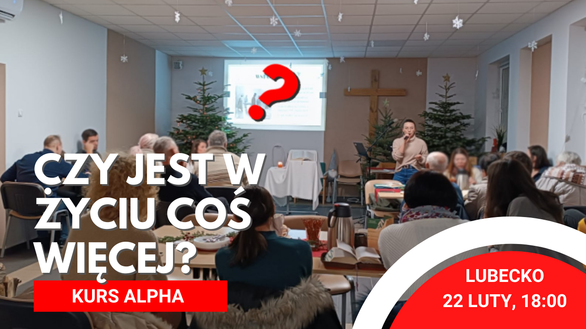

## Czym jest Kurs Alpha

Alpha to seria **11 spotkań i weekendu lub Dnia Alpha**. Kurs:

- jest bezpłatny dla uczestników;
- jest skierowany przede wszystkim do osób niewierzących i poszukujących;
- pozwala nowym osobom dołączyć do czwartego spotkania.

Najprostsze wyjaśnienie formatu brzmi:

> **Kolacja + film + rozmowa.**

Przykładowe spotkanie trwa około dwóch godzin:

- 30 minut kolacji;
- 30 minut filmu;
- 45 minut rozmowy;
- pozostały czas obejmuje rozpoczęcie, przejścia między częściami i zakończenie.

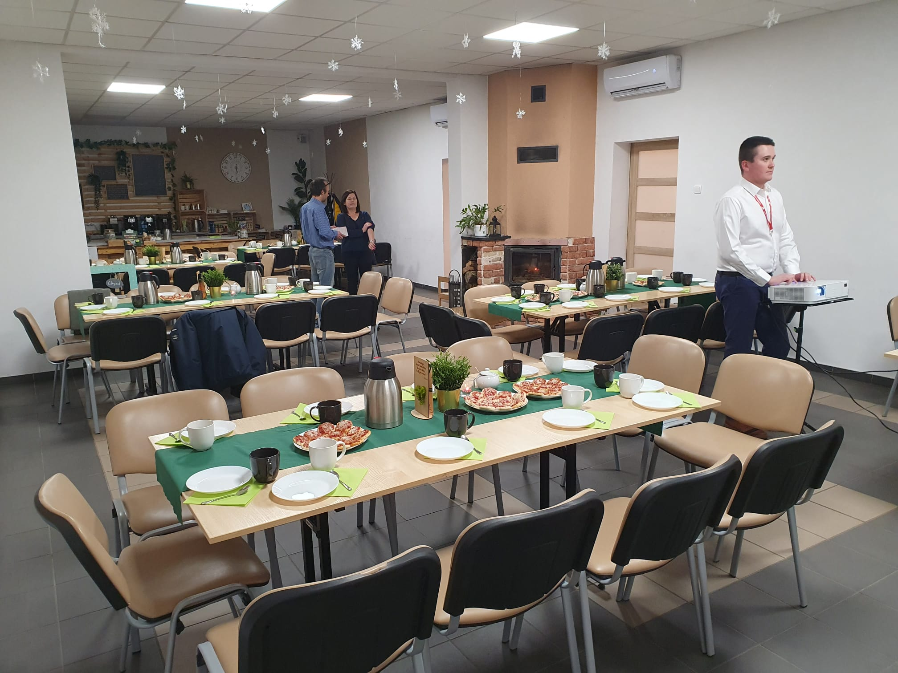

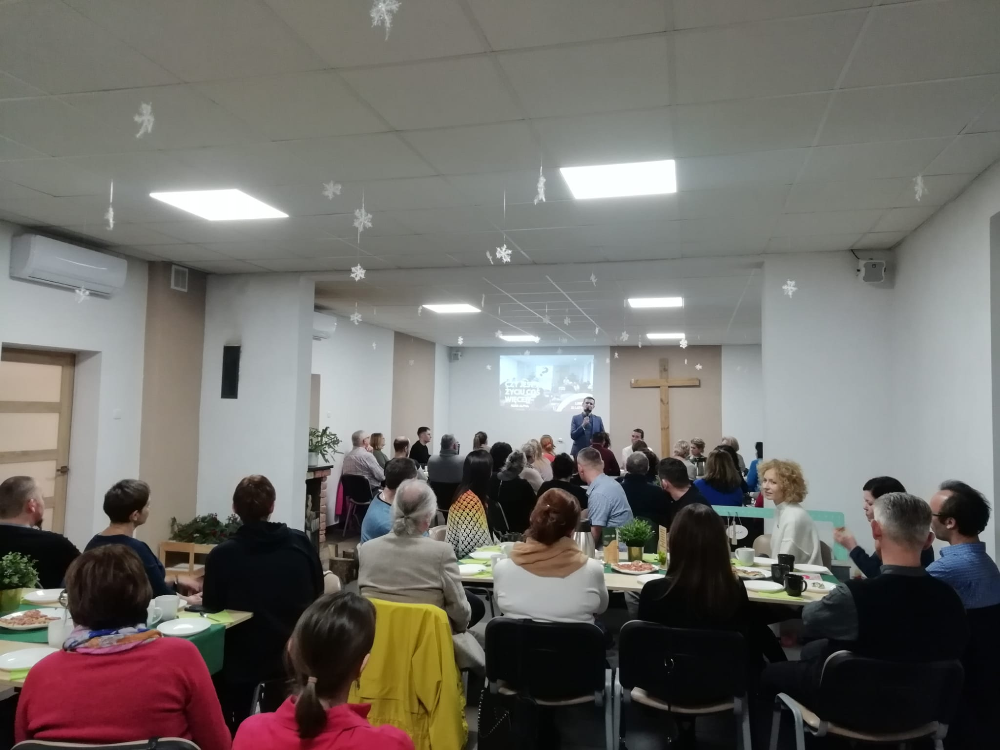

## Krótka historia Alpha

Według prezentacji:

- współczesna Alpha rozwinęła się w Kościele anglikańskim; od 1992 roku Nicky Gumbel był jej głównym propagatorem i pomógł wyskalować program na świecie;
- w Polsce Alpha jest prowadzona od 1999 roku;
- w chwili przygotowania prezentacji Alpha miało ukończyć ponad 24 miliony osób w 169 krajach;
- Alpha jest dziełem międzynarodowym, wspieranym przez krajowe biura;
- pierwsze katolickie Alphy przy parafiach były prowadzone na podstawie skryptu;
- polski Episkopat wydał „Dyrektorium Alpha”, które przedstawia oficjalne stanowisko i zachęca do prowadzenia Alpha w parafiach.

> „Widzimy, że Alpha jest bardzo przydatnym narzędziem, które działa w parafiach, nie tylko w parafiach w mieście, ale także w tych na wsiach. To bardzo ważne, ponieważ nie mamy wielu instrumentów ewangelizacji dla wiejskich parafii”.
>
> Abp Grzegorz Ryś, metropolita łódzki — cytat przytoczony w prezentacji.

## Jak Alpha zaczęła się w Lubecku

Punktem wyjścia były dwa odwołane Kursy Nowe Życie. Nie było wystarczającej liczby uczestników. Pojawiło się pytanie: **co dalej?**

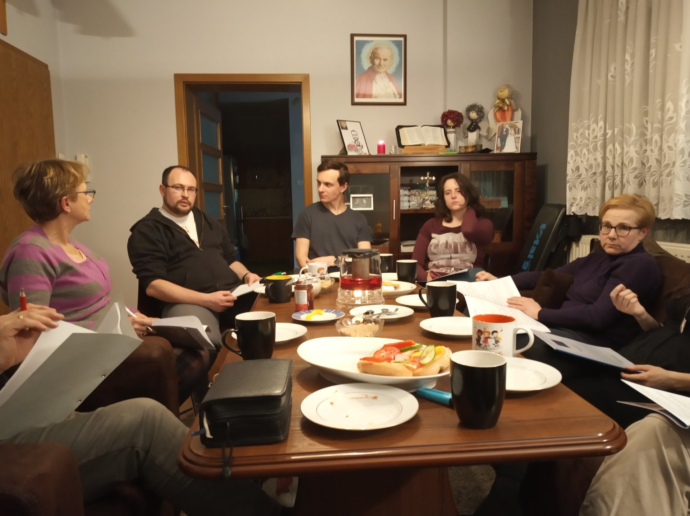

Pierwsza decyzja brzmiała: **„Sprawdźmy Alpha na sobie”**. Zespół najpierw przeżył format we własnym gronie. W prezentacji zachowały się zdjęcia pierwszych materiałów, wspólnego stołu i modlitwy.

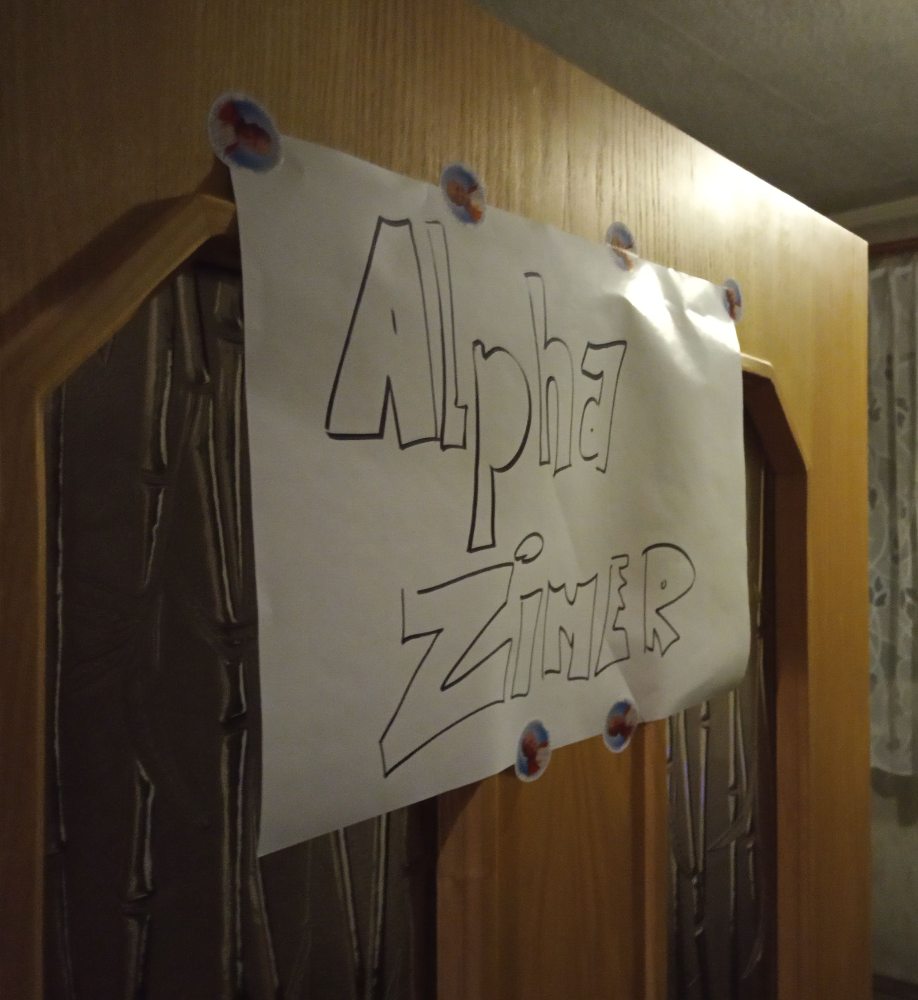

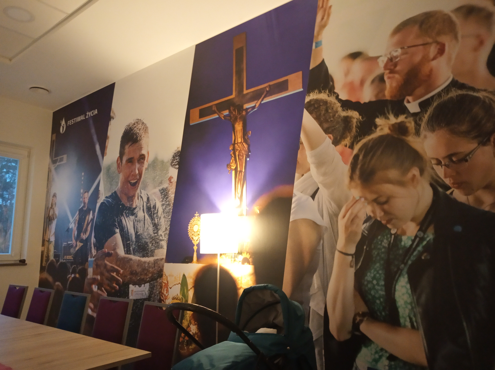

Kolejnym krokiem było przygotowanie miejsca i rozpoczęcie regularnych edycji.

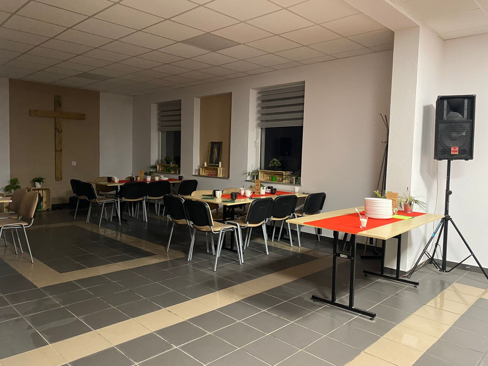

### Drugi Dzień Alpha podczas 2. edycji

Podczas drugiej edycji odbył się nasz drugi Dzień Alpha. Był to czas wspólnej modlitwy, spotkania oraz posiłku przy jednym stole.

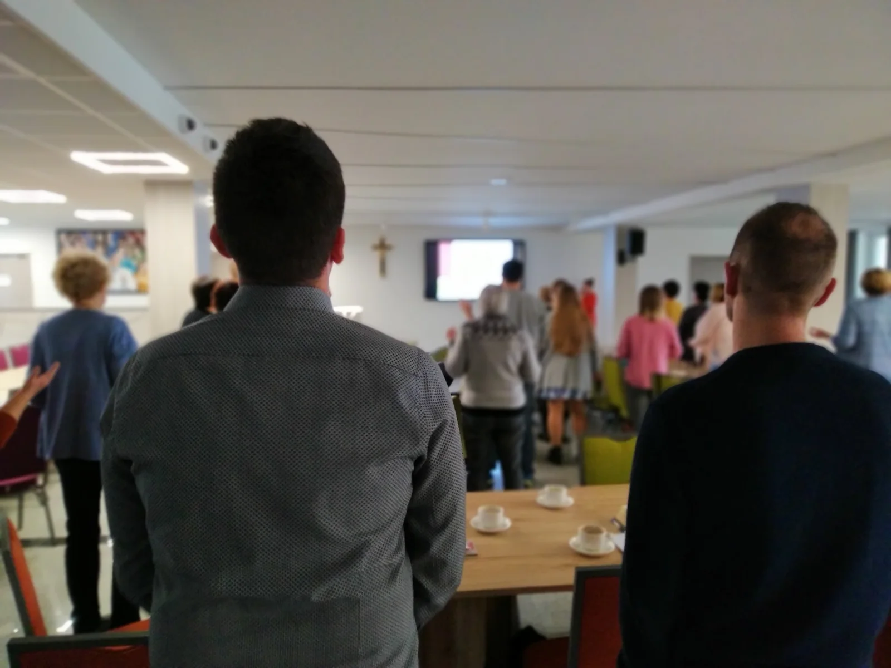

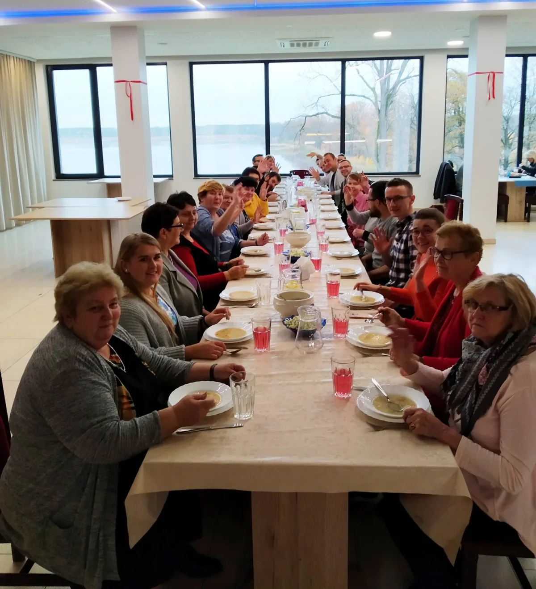

### Stan zapisany w prezentacji

W chwili przygotowania slajdów historia obejmowała:

- siedem edycji Alpha, w tym edycję online;
- jedną Alpha dla młodzieży;
- traktowanie Alpha jako „silnika parafii”, który stawia ewangelizację w centrum;
- dzielenie się doświadczeniem z parafiami i wspólnotami w Koszęcinie, Zabrzu, Toszku, Gliwicach i innych miejscach.

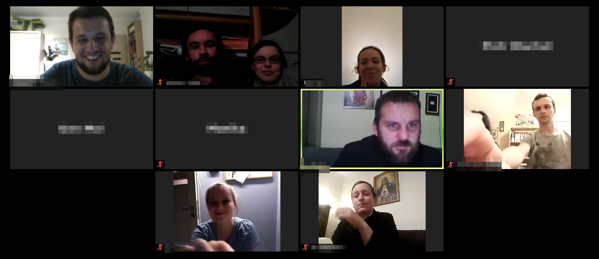

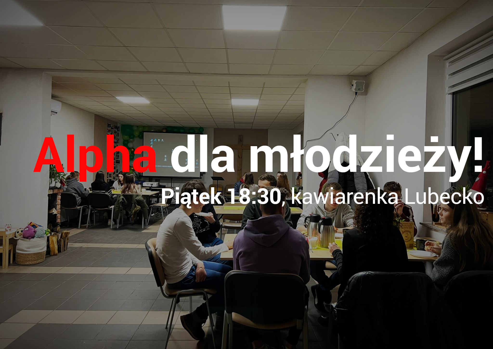

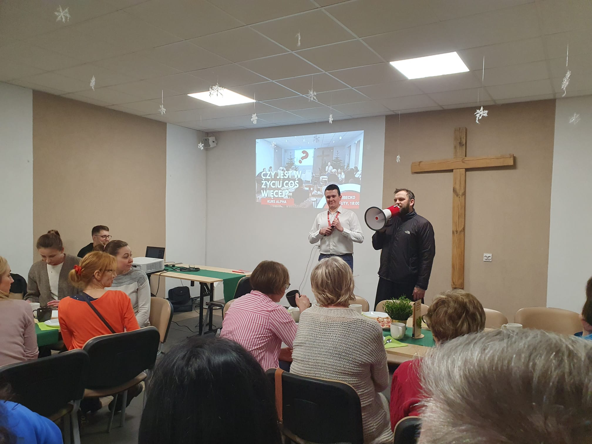

### Aktualizacja

W 2025 roku zakończyła się jubileuszowa, dziesiąta edycja Alpha Lubecko. **Obecnie trwa jedenasta edycja.** Szczegółowy wykaz edycji i działań znajduje się w [[regionalne_centrum_alpha_lubecko]].

## Dlaczego Alpha działa

### Zalety

- **Relacyjność** — wspólny posiłek, rozmowa i wiele kolejnych spotkań tworzą przestrzeń do budowania relacji.
- **Skalowalność** — Alpha może zacząć się w pokoju, przenieść do salki, a później do większej sali lub restauracji.
- **Odtwarzalność** — filmy pozwalają uruchomić kurs bez budowania całego programu od początku.
- **Niski próg wejścia** — format jest dostępny dla osób niewierzących i poszukujących.
- **Proste zaproszenie** — łatwo wyjaśnić, na czym polega spotkanie.
- **Kerygmatyczność** — pierwsze spotkania, weekend i spotkanie końcowe prowadzą uczestników przez najważniejsze treści wiary.
- **Ekumeniczność** — Alpha otwiera na współpracę chrześcijan różnych tradycji.
- **Wsparcie** — krajowe biuro, gotowe materiały i doświadczenie innych wspólnot pomagają nowym zespołom.
- **Formacja liderów** — kolejne edycje uczą nowe osoby odpowiedzialności i służby.

W prezentacji zapisano praktyczny znak relacyjności Alpha: uczestnicy nie chcieli, żeby kurs się kończył. Jako owoc formacyjny wskazano także widoczny rozwój osób zaangażowanych w ekipę.

### Trudności i koszty

- kurs trwa 11 tygodni i obejmuje dodatkowy dzień lub weekend;
- terminy mogą wypadać w dni wolne lub okresy trudniejsze organizacyjnie;
- członkowie ekipy mogą zacząć wybierać samą posługę zamiast osobistego uczestnictwa w spotkaniu;
- niedyrektywny charakter Alpha może sprawiać wrażenie, że modlitwy jest mało;
- posiłki i organizacja weekendu generują koszty.

## Znaczenie dla strony internetowej RCA

Ta część materiału powinna stanowić podstawę strony skierowanej do osób, które dopiero rozważają Alpha. Najważniejsze elementy przekazu to:

1. prostota formatu: **kolacja, film, rozmowa**;
2. niski próg wejścia dla gości;
3. lokalna historia: od dwóch odwołanych Kursów Nowe Życie do jedenastej edycji Alpha;
4. zdjęcia pokazujące rzeczywistą atmosferę spotkań;
5. rozwój od własnych edycji do szkolenia innych parafii;
6. uczciwe pokazanie zarówno zalet, jak i kosztów organizacyjnych.

### Dane potrzebne do opisania owoców

Prezentacja mówi o widocznym wzroście osób formowanych w ekipie, ale nie podaje dokładnej liczby, o jaką zwiększyła się wspólnota. Przed opublikowaniem strony trzeba uzupełnić:

- liczebność wspólnoty przed pierwszą Alphą;
- obecną liczebność wspólnoty;
- liczbę osób, które po Alpha weszły do wspólnoty lub podjęły posługę;
- liczbę uczestników wszystkich edycji.

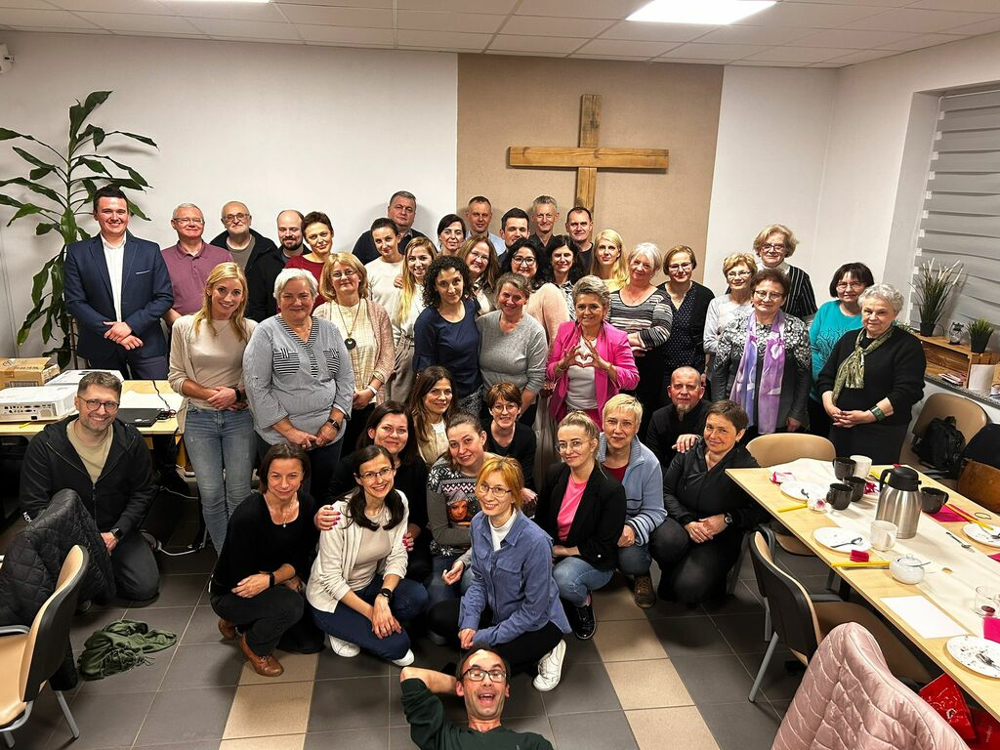

Prezentację zamyka zaproszenie na Alpha i świadectwo Grzesia. W slajdach nie zapisano treści tego świadectwa.
