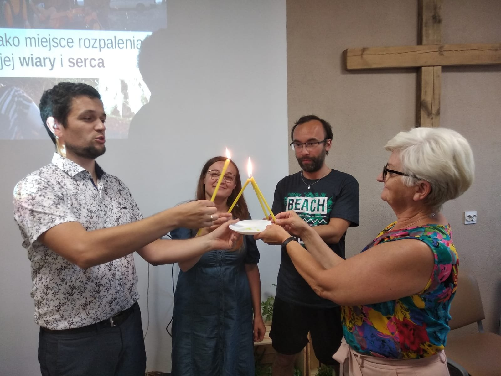
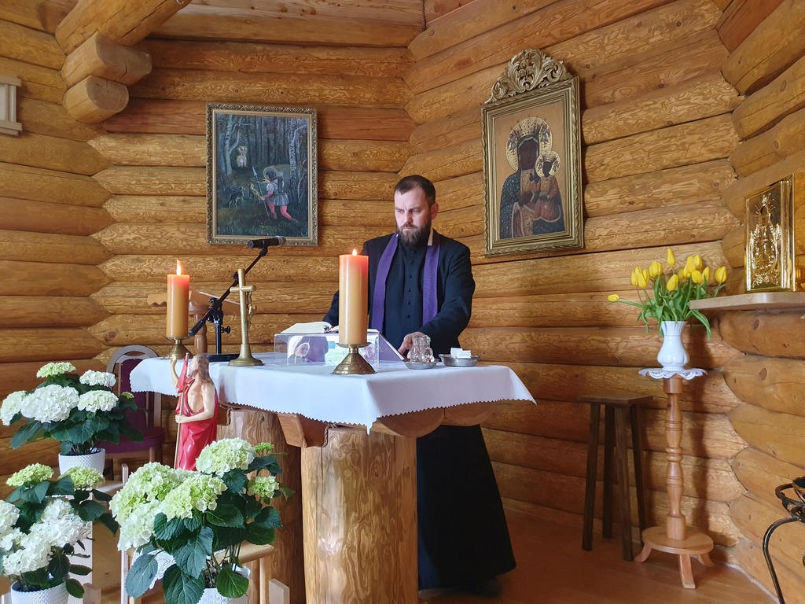
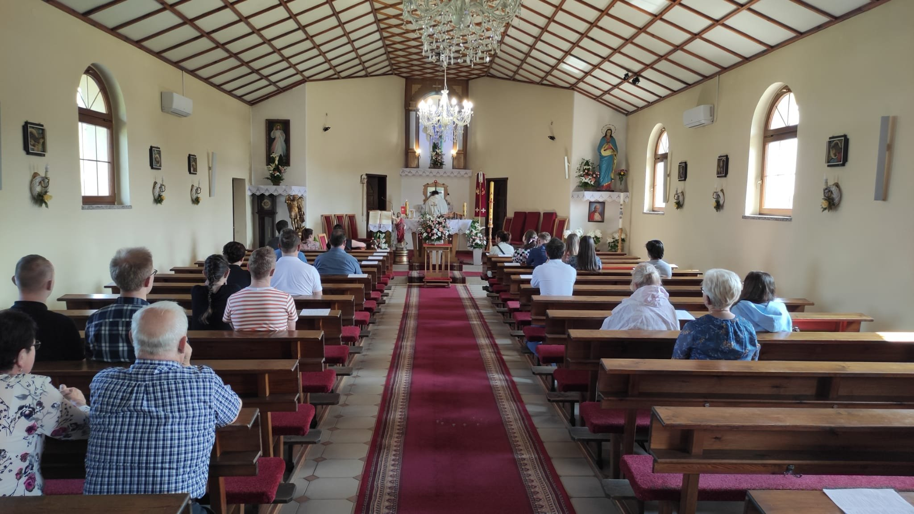
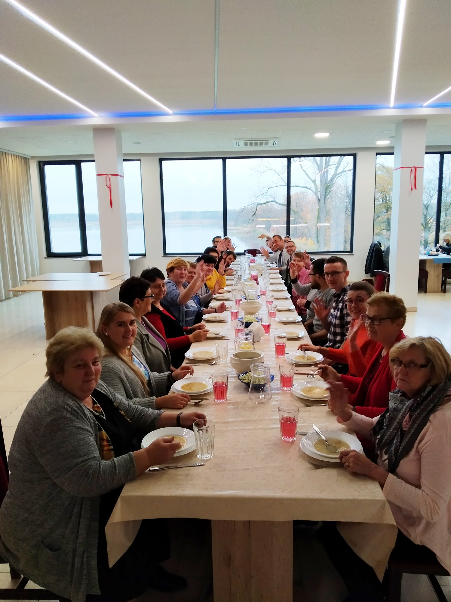
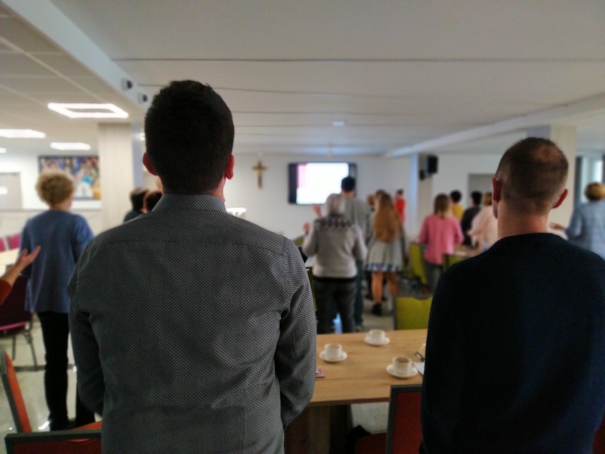

# Jak prowadzić Alpha

> Opracowanie prezentacji [[4. Szkolenie CZ2.pptx]] i jej wersji [[4. Szkolenie CZ2.pdf]]. PPTX ma 24 slajdy i jest wersją pełniejszą. PDF ma 21 stron i nie zawiera slajdów o koordynatorach, miejscu oraz promocji. W PDF-ie idealna grupa liczy 10 osób i ma jednego pomocnika, natomiast w PPTX-ie liczy 11 osób i ma dwóch pomocników. W tym opracowaniu przyjęto treść z PPTX.

## Ćwiczenie prowadzenia grupy

Prezentacja rozpoczyna się od praktycznego ćwiczenia. Grupa składa się z gospodarza, pomocników i dwóch osób z zewnątrz.

### Wariant 10-minutowy — sesja 8

1. Co znaczy dla ciebie przebaczenie?
2. Co myślicie o Jezusie?
3. Gdybyście mieli okazję spotkać Jezusa, jak byście się poczuli i co chcielibyście Mu powiedzieć?

### Wariant 60-minutowy — sesja 3

1. Co znaczy dla ciebie słowo „przebaczenie”?
2. Czy kiedykolwiek musieliście komuś przebaczyć? Jak to zrobiliście?
3. Co oznacza dla was słowo „grzech”?

## Mała grupa Alpha

Idealna grupa przedstawiona w PPTX liczy 11 osób:

- ośmiu uczestników;
- jeden gospodarz;
- dwóch pomocników.

**Gospodarz** prowadzi rozmowę, pozostaje przy swoim stoliku i poznaje gości. Nie pełni tej samej roli co animator prowadzący katechezę.

**Pomocnik** troszczy się o uczestników, towarzyszy im i sam dzieli się swoim doświadczeniem.

Materiały dla ekipy są dostępne w sklepie Alpha Polska: [sklep.alphapolska.org](https://sklep.alphapolska.org/).

## Koordynatorzy Alpha

Prezentacja zaleca, aby funkcję koordynatorów pełniły dwie osoby. Koordynatorzy:

- rozdzielają i delegują zadania;
- prowadzą poszczególne spotkania, jeśli tej roli nie powierzono innej osobie;
- odpowiadają za logistykę;
- powinni być dobrze zorganizowani i mieć doświadczenie w prowadzeniu Alpha;
- ponoszą odpowiedzialność pasterską za ekipę.

W materiale porównano ten model do współpracy dyrektora i koordynatora w metodologii SESA.

## Miejsce

Miejsce trzeba wybrać z myślą o gościach. Powinno pozwalać im czuć się swobodnie. Warto urządzić je przytulnie i tak, żeby wspólnie spędzony czas był przyjemnością.

## Promocja

Najważniejszą i najskuteczniejszą formą promocji jest **osobiste zaproszenie**. Wspólnota powinna zapraszać szeroko. Inne działania wspierają osobiste zaproszenie i otwierają do niego drogę:

- plakaty i składane zaproszenia;
- płatna lub bezpłatna reklama w mediach społecznościowych;
- ogłoszenia parafialne;
- newsletter;
- zbieranie kontaktów do osób zainteresowanych;
- materiały dostępne przez Alpha Polska: grafiki, filmy, ulotki, plakaty, roll-up i baner.

Materiały organizacyjne: [poprowadz.alpha.org.pl](https://poprowadz.alpha.org.pl/).

## Prowadzenie rozmowy

Trzy kluczowe elementy to:

### Miłość — kochać ludzi

Najlepszą rzeczą, jaką można zrobić, jest dzielić się swoim życiem z gośćmi w sposób pełen miłości i szacunku.

> „Ludzie przychodzą do kościoła z różnych powodów, ale pozostają tylko z jednego — przyjaźni”.
>
> John Wimber, założyciel Vineyard Church — cytat przytoczony w prezentacji.

W materiale jako przykład wskazano rozmowę o charyzmacie gościnności w Lubecku.

### Słuchanie — pozwolić mówić

Gospodarz powinien pozwolić ludziom mówić i naprawdę ich słuchać. Grupa Alpha nie opiera się na relacji nauczyciel–uczeń, ale na relacji gospodarz–gość.

> „Ludzie nie są bliżej odkrycia właściwej odpowiedzi niż wtedy, gdy swobodnie dyskutują”.
>
> Thomas Macaulay — cytat przytoczony w prezentacji.

Nie trzeba odpowiadać na wszystkie pytania ani przekonywać na siłę. Lepiej, żeby uczestnik wrócił za tydzień, niż żeby zraził się podczas jednej rozmowy.

### Śmiech — unikać napięcia

Doświadczenie Alpha powinno być nieformalne i swobodne. Śmiech pomaga rozładować napięcie. Celem jest stworzenie takiej atmosfery, żeby goście chcieli wrócić za tydzień.

## Dlaczego grupy się nie udają

Prezentacja wskazuje dwa główne problemy:

- gospodarze i pomocnicy mówią zbyt dużo;
- jeden z uczestników zaczyna dominować w rozmowie, a gospodarze na to pozwalają.

## Przebieg całej Alpha

1. **Spotkania 1–4:** Jezus i kerygmat. Na tym etapie mogą dołączać nowe osoby.
2. **Spotkanie 5:** modlitwa staje się stałym elementem spotkań.
3. **Po spotkaniu 7 lub 8:** weekend lub Dzień Alpha poświęcony Duchowi Świętemu i modlitwie o Jego działanie.
4. **Pozostałe spotkania:** tematy katechetyczne.
5. **Spotkanie 10:** uzdrowienie i modlitwa.
6. **Spotkanie 11:** wspólnota, agapa i zakończenie.

## Weekend lub Dzień Alpha

To kulminacyjny punkt kursu, poświęcony osobie Ducha Świętego. Zalecana jest zmiana miejsca i forma wyjazdowa. Program obejmuje trzy sesje o Duchu Świętym.

Weekend lub dzień tworzy więcej przestrzeni na modlitwę i otwarcie się na działanie Boga. Materiał wymienia:

- możliwość spowiedzi;
- modlitwę o przebaczenie;
- modlitwę o doświadczenie obecności Ducha Świętego;
- Eucharystię.

## Wieczór od strony ekipy

Przykładowy plan:

- 17:00 — kuchnia i przygotowanie sprzętu;
- 18:00 — kolacja;
- 18:30 — film;
- 19:00 — rozmowa w grupach;
- 20:30–21:30 — spotkanie ekipy.

W duchu SESA spotkanie ekipy obejmuje wspólną modlitwę i podsumowanie wieczoru.

## Posługi w ekipie

- dyrektor i koordynator — dwie osoby koordynujące;
- kuchnia;
- osoba odpowiedzialna za projektor i sprzęt;
- gospodarze;
- pomocnicy.

## Podsumowanie prezentacji

> Jeśli Kurs Nowe Życie oznacza sianie i zbiory, to Alpha przypomina oranie i bronowanie pola. Przygotowuje podłoże parafii pod zasiew i rozwój wspólnoty.

## Znaczenie dla strony internetowej RCA

Ten materiał służy przede wszystkim szkoleniu ekip. Na publicznej stronie warto wykorzystać jedynie najprostsze elementy:

- osobiste zaproszenie jest podstawą promocji;
- spotkanie tworzą kolacja, film i rozmowa;
- gospodarz słucha i pomaga rozmawiać, zamiast prowadzić wykład;
- RCA pomaga przygotować ekipę, miejsce, promocję i pierwszą edycję.

Szczegóły ról, harmonogramu, prowadzenia grupy i Dnia Alpha powinny pozostać w części szkoleniowej bazy wiedzy.
