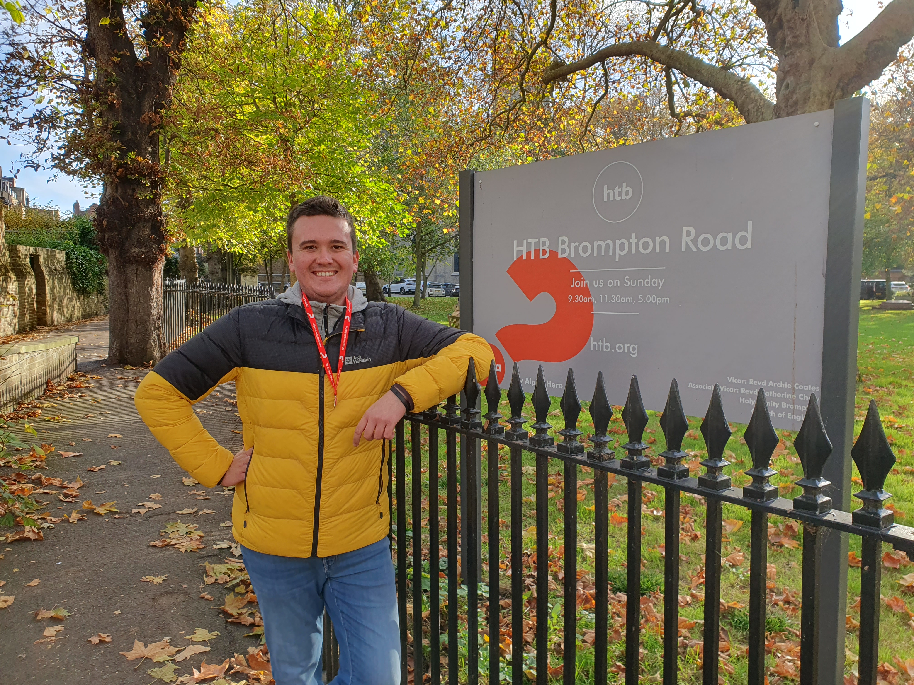
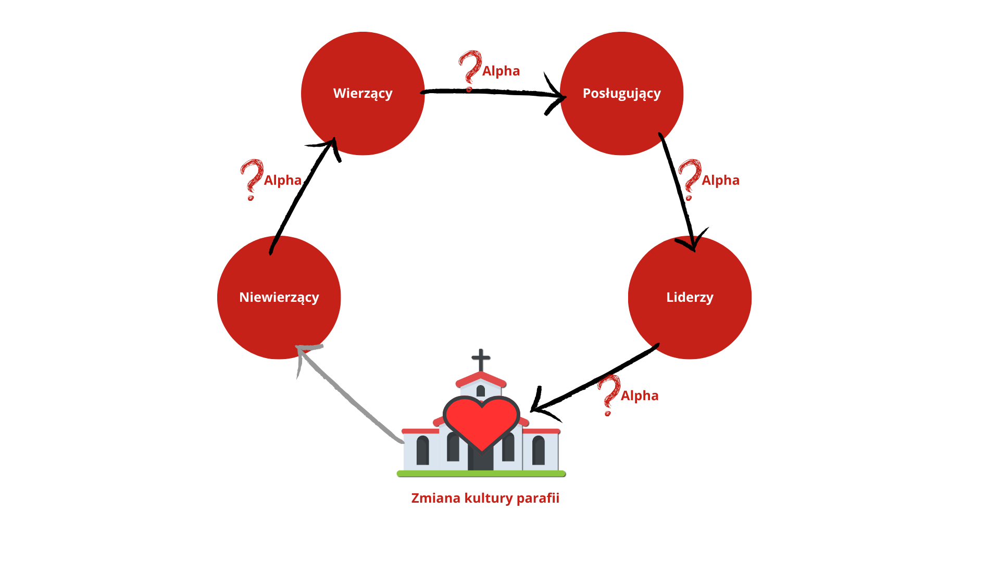
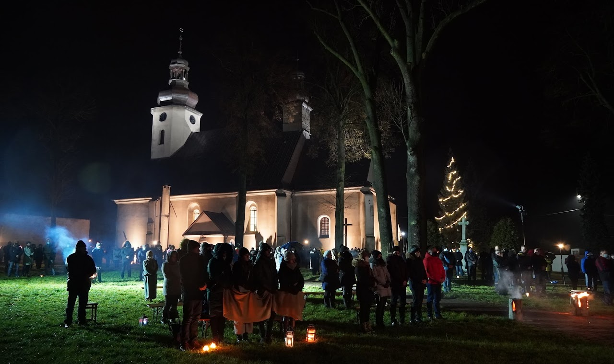
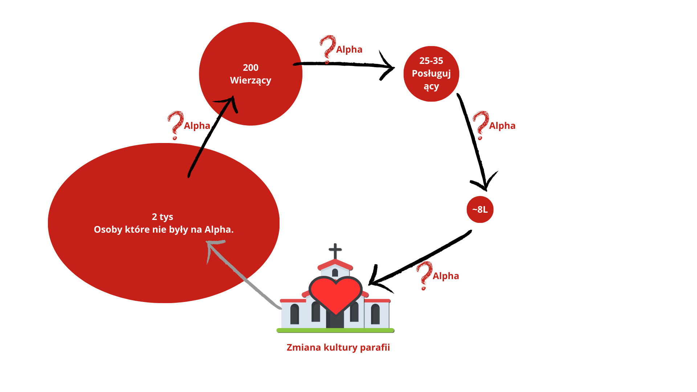
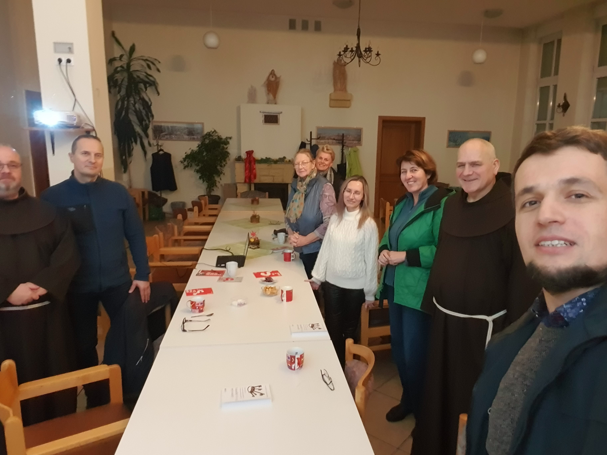
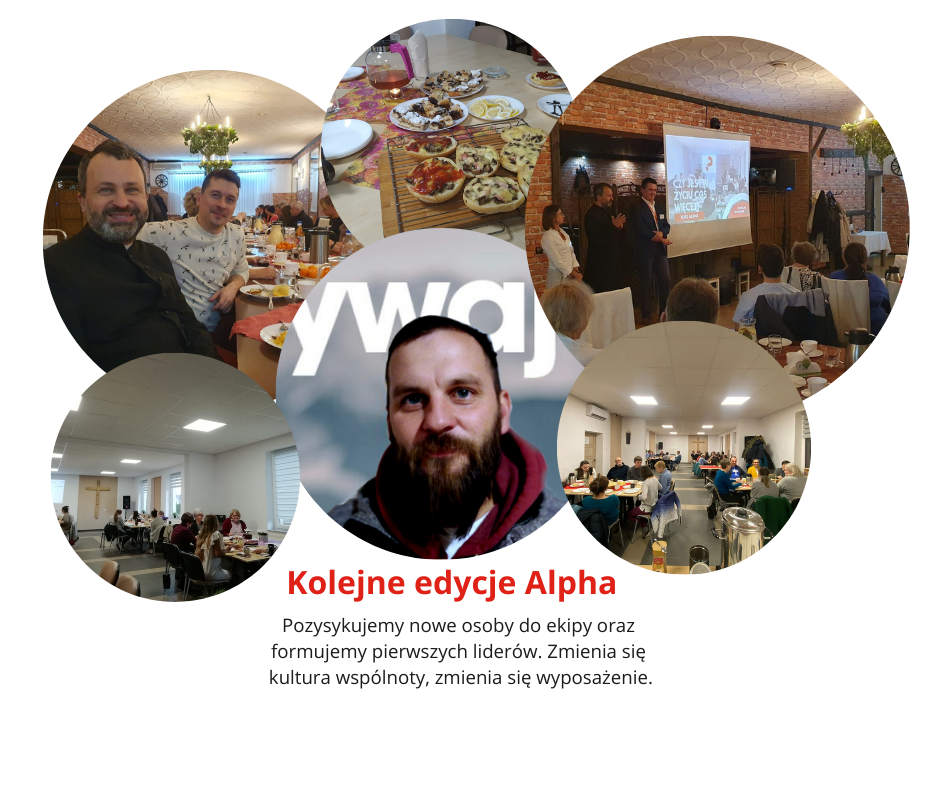
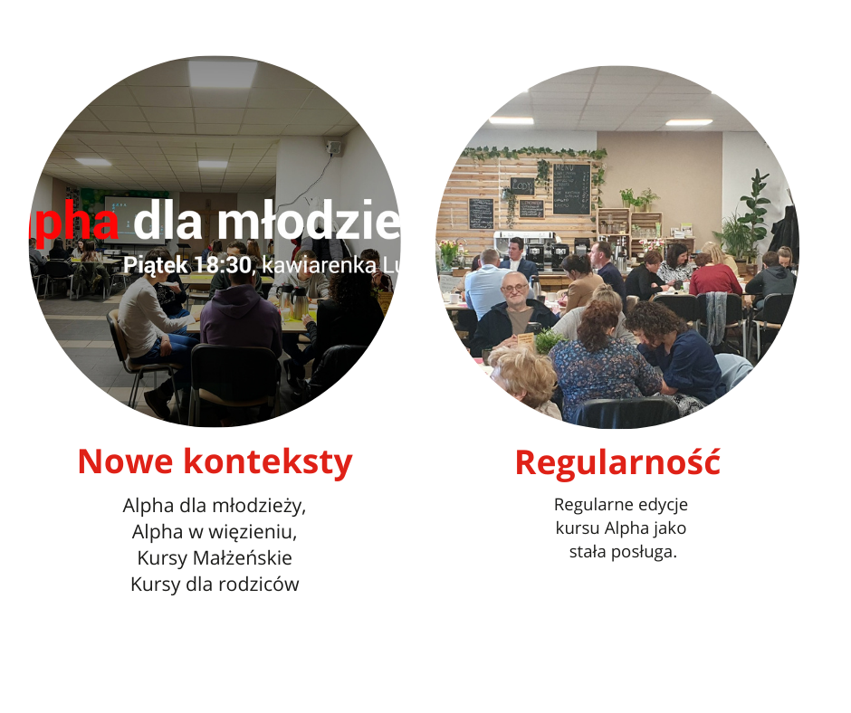
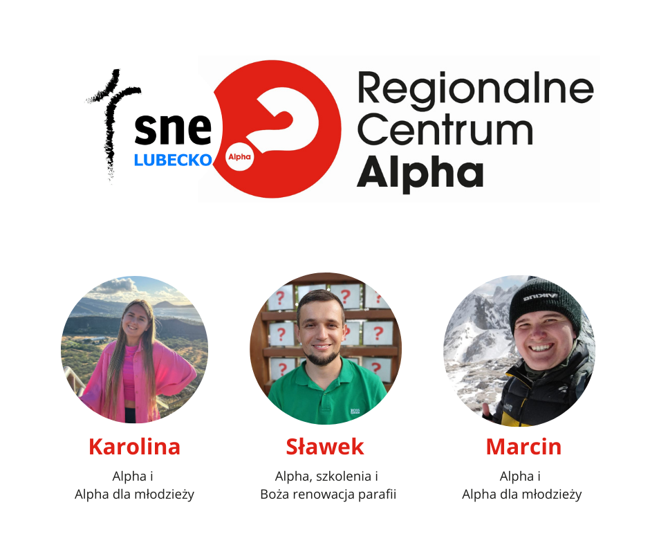
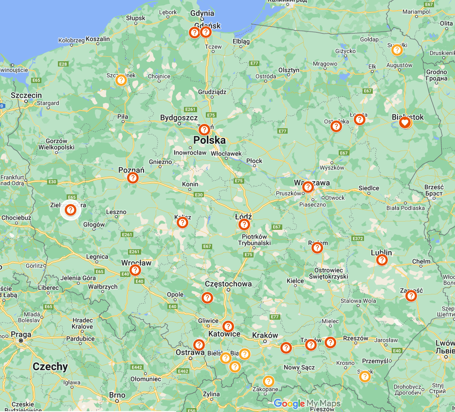
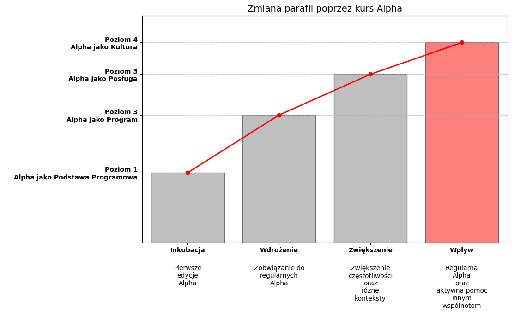

# Wizja Alpha i cykl Bożej renowacji

> Opracowanie prezentacji [[4. Szkolenie CZ3.pptx]] i jej wersji [[4. Szkolenie CZ3.pdf]]. PPTX ma 29 slajdów i jest wersją pełniejszą. PDF ma 25 stron i pomija cztery slajdy o wizji, misji, skali i wpływie Alpha.

## Wizja Alpha

Na wizję Alpha składają się:

- ewangelizacja narodów;
- rewitalizacja Kościoła;
- transformacja społeczeństwa poprzez zmianę życia pojedynczych osób.

Prezentacja wskazuje jako źródło tego ujęcia „Dyrektorium Alpha”.

## Misja Alpha

> Jesteśmy po to, by wyposażać Kościół w narzędzia do głoszenia Ewangelii i wspierać go w misji odkrywania i rozwijania relacji z Jezusem.

## Skala i wpływ przedstawione w prezentacji

W prezentacji podano, że Alpha przeszło ponad 20 milionów osób:

- w 169 krajach;
- w 112 językach;
- w 88 000 miejsc.

W innym materiale szkoleniowym, [[01_czym_jest_alpha_i_historia_lubecka]], występuje liczba ponad 24 milionów osób. Dane pochodzą z różnych wersji prezentacji i przed publikacją na stronie wymagają aktualizacji.

Slajd o wpływie Alpha podaje następujące zmiany wśród gości, którzy przed Alpha określali się jako niewierzący:

- 88% bardziej angażuje się w osobistą relację z Jezusem Chrystusem;
- 88% bardziej angażuje się w poznawanie Biblii;
- 80% bardziej angażuje się w dzielenie się wiarą z innymi;
- 69% bardziej angażuje się w nabożeństwa w swoim kościele.

Prezentacja nie zawiera źródła, daty, liczebności próby ani opisu metodologii tych danych. Przed wykorzystaniem ich na stronie trzeba odnaleźć badanie źródłowe.

## Alpha jako jedno z narzędzi Kościoła

Diagram pokazuje Kościół jako centrum, wokół którego działają narzędzia docierające do nowych osób:

- Alpha;
- Kurs Przedmałżeński;
- Kurs Małżeński;
- Kursy dla rodziców;
- Alpha dla młodzieży;
- Alpha w więzieniu.

Każde narzędzie tworzy inną drogę wejścia. Wszystkie pomagają przyprowadzać nowych uczestników do Kościoła i budować relację z Jezusem. Prezentacja przypomina także o rejestrowaniu prowadzonej Alpha i kontakcie z koordynatorem regionalnym.

## Jak Alpha zmienia parafię

### Cykl Bożej renowacji

Diagram oparty na idei z książki ks. Jamesa Mallona pokazuje kolejne przejścia:

1. **Niewierzący staje się wierzącym.** Alpha tworzy bezpieczną drogę pierwszego spotkania z Ewangelią.
2. **Wierzący zaczyna posługiwać.** Kolejna edycja daje mu możliwość wejścia do ekipy i służby innym.
3. **Posługujący staje się liderem.** Odpowiedzialność i praktyka pomagają formować gospodarzy, koordynatorów i następnych liderów.
4. **Liderzy zmieniają kulturę parafii.** Ewangelizacja przestaje być jednorazową akcją i staje się stałym sposobem działania wspólnoty.
5. **Zmieniona parafia ponownie dociera do niewierzących.** Cykl zaczyna się od nowa i może się powtarzać.

> „Jeśli ewangelizacja jest na pierwszym miejscu w parafii, to wszystko jest na właściwym”.
>
> ks. James Mallon — cytat przytoczony w prezentacji.

### Owoce uboczne zmiany kultury

W prezentacji nazwano je *emergent properties*: nowe dzieła wyrastają z kultury, w której ludzie przechodzą drogę od uczestnika do osoby odpowiedzialnej. W Lubecku jako przykłady pokazano:

- kawiarenkę;
- Godly Play;
- kursy dla par;
- Alpha dla młodzieży.

## Lokalny obraz koła

Jeden ze slajdów pokazuje roboczy model lokalnej sytuacji:

- około 200 wierzących;
- 25–35 osób posługujących;
- około 8 liderów;
- około 2 tysiące osób, które nie uczestniczyły w Alpha.

Diagram nie jest opatrzony datą ani metodą wyliczenia. Należy traktować go jako ilustrację szkoleniową i punkt wyjścia do pytania:

> **Jak to koło wygląda w twojej parafii?**

## Cztery etapy rozwoju Alpha

Materiał zaprasza każdą wspólnotę do odpowiedzi na pytanie: **na jakim etapie rozwoju Alpha dzisiaj jesteś?**

### 1. Inkubacja — pierwsze edycje

1. Szkolenie.
2. Udział w istniejącej edycji.
3. Własna edycja ucząca.
4. Pierwsza edycja publiczna.

### 2. Wdrożenie — kolejne edycje

Wspólnota organizuje kolejne edycje, pozyskuje osoby do ekipy i formuje pierwszych liderów. Zmienia się kultura wspólnoty oraz jej zaplecze organizacyjne i techniczne.

### 3. Wzrost — nowe konteksty i regularność

Alpha zaczyna działać regularnie i pojawia się w nowych kontekstach:

- Alpha dla młodzieży;
- Alpha w więzieniu;
- Kurs Małżeński;
- kursy dla rodziców.

### 4. Wpływ — pomoc innym wspólnotom

Alpha staje się częścią kultury wspólnoty. Doświadczeni liderzy zaczynają aktywnie wspierać inne parafie i zespoły. W tym miejscu pojawia się rola Regionalnego Centrum Alpha.

Na wykresie źródłowym oznaczenia poziomów zawierają powtórzony numer 3:

- poziom 1 — Alpha jako podstawa programowa;
- poziom 3 — Alpha jako program;
- poziom 3 — Alpha jako posługa;
- poziom 4 — Alpha jako kultura.

To oznaczenie zachowano jako treść prezentacji. Przed ponownym użyciem wykresu warto ustalić, czy drugi poziom 3 miał być poziomem 2.

## Znaczenie dla strony internetowej RCA

Ten materiał zawiera główny argument dla osoby, która widzi, że jej parafia gaśnie i szuka narzędzia zmiany:

- Alpha zaprasza osoby spoza aktywnego życia Kościoła;
- część uczestników wchodzi później do ekipy;
- ekipa formuje posługujących i nowych liderów;
- liderzy uruchamiają kolejne edycje i nowe dzieła;
- regularność zmienia kulturę parafii;
- dojrzała wspólnota może szkolić i wspierać następne miejsca.

Historia Lubecka pokazuje tę drogę praktycznie: od sprawdzania Alpha we własnym gronie, przez regularne edycje, aż do działalności Regionalnego Centrum Alpha. Obecnie trwa jedenasta edycja Alpha w Lubecku.
