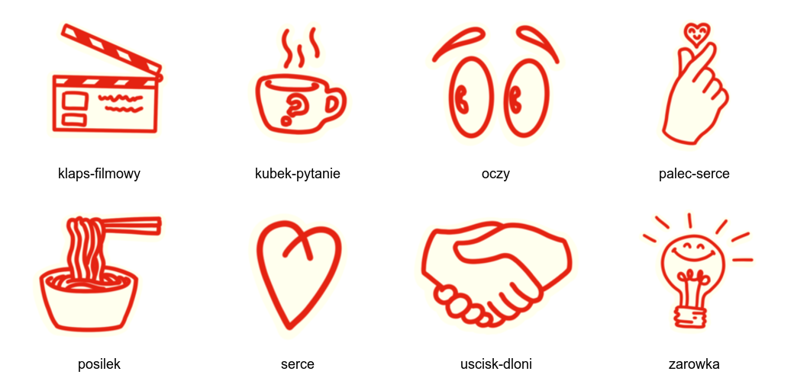
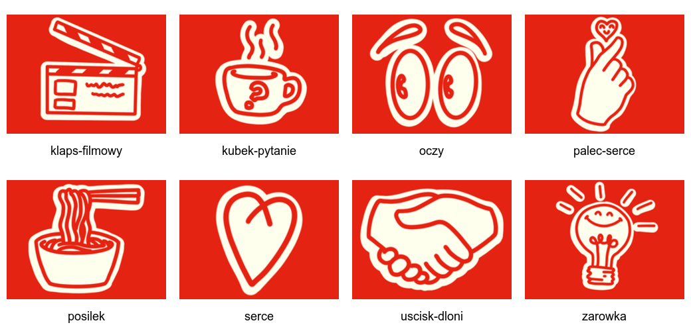

# Identyfikacja wizualna materiałów Alpha

Ten katalog zawiera roboczą dokumentację nowej stylistyki widocznej w materiałach wydarzeniowych oraz elementy wydobyte bezpośrednio z prezentacji [[Prezentacja_vA.pptx]] i [[Prezentacja_vB.pptx]].

> **Aktualna referencja dla nowych materiałów:** [[../brandbook_2026/README]]. Niniejszy opis pozostaje dokumentacją lokalnych, wcześniejszych prezentacji i pomocniczych zasobów.

## Czcionki

W obu prezentacjach zapisano następujące fonty używane jako część projektu:

| Font | Zastosowanie |
| --- | --- |
| **Plus Jakarta Sans** | tekst podstawowy, krótkie opisy i część nagłówków |
| **Plus Jakarta Sans Bold** | nagłówki, tytuły i mocne wyróżnienia |
| **Instrument Serif Italics** | duże, charakterystyczne hasło „Tak, to jest Alpha!” oraz podpisy w tym stylu |
| **Oswald Light** | dodatkowy tekst na pierwszych planszach wariantu A, m.in. zdanie „Alpha jest dla każdego, kto jest ciekawy” |

Nazwa `Instrument Serif Italics` została przepisana dokładnie z pliku PPTX. W programach graficznych font może występować jako rodzina **Instrument Serif** w odmianie *Italic*.

Arial, Times New Roman i Calibri znajdują się w technicznych ustawieniach motywu lub jako fonty zastępcze. Nie tworzą głównego języka wizualnego tych materiałów.

## Kolorystyka

Kolory poniżej pochodzą z wypełnień i tekstów zapisanych w prezentacjach.

| Rola | HEX | RGB |
| --- | --- | --- |
| czerwony Alpha, ikony i tytuły | `#E42312` | 228, 35, 18 |
| kremowy, wnętrze ikon i tekst na ciemnym tle | `#FFFFEE` | 255, 255, 238 |
| jasny róż | `#FACBC7` | 250, 203, 199 |
| jasny brzoskwiniowy | `#F7D9BC` | 247, 217, 188 |
| fiolet | `#5F5BA5` | 95, 91, 165 |
| ciemna czerwień | `#9D0000` | 157, 0, 0 |
| ciemna zieleń | `#144A38` | 20, 74, 56 |
| śliwkowy | `#402854` | 64, 40, 84 |
| czerń | `#000000` | 0, 0, 0 |
| biel | `#FFFFFF` | 255, 255, 255 |

Osadzony czerwony znak Alpha ma nieco inny odcień niż podstawowa czerwień układów: przede wszystkim `#E42F24`, z detalami `#E32826`. Nie należy automatycznie zamieniać tych kolorów wewnątrz oryginalnego logo.

Szare plansze wykorzystują fotografię faktury papieru lub betonu, dlatego nie mają jednego koloru HEX.

## Język wizualny

- Duże hasła są składane kursywą szeryfową, a informacje użytkowe prostym fontem bezszeryfowym.
- Zdjęcia występują jako czarno-białe wycięcia postaci albo ciepłe fotografie ludzi przy wspólnym stole.
- Układy są asymetryczne. Fotografia, pionowy pas koloru albo grupa osób często dochodzi do prawej lub lewej krawędzi.
- Czerwone konturowe ikony z kremowym wypełnieniem są rozsiane wokół zdjęć i tekstu jako swobodne, odręczne akcenty.
- Na ciemnych tłach tekst, logo i część elementów przechodzą na kolor kremowy.
- Kompozycje pozostawiają dużo wolnej przestrzeni na tytuł i krótki tekst.

## Wydobyte ikony

Z obu prezentacji wydobyto osiem unikalnych ikon:

1. klaps filmowy;
2. kubek z pytajnikiem;
3. oczy;
4. gest palca z sercem;
5. posiłek w misce;
6. serce;
7. uścisk dłoni;
8. żarówka.

Oryginalne pliki znajdują się w katalogu [`ikony/oryginalne/`](ikony/oryginalne/). Są to przezroczyste pliki PNG o wymiarach 547 × 410 px, zachowane bez przerysowywania i bez zmiany kolorów.

Warianty w katalogu [`ikony/na-tle-alpha/`](ikony/na-tle-alpha/) mają czerwone tło `#E42312`. Zachowują kremowe wypełnienie i czerwony rysunek oryginalnych ikon.

## Logo

W katalogu [`logo/`](logo/) znajdują się wersje znaku Alpha w formatach SVG i PNG:

- `alpha-czerwone.svg` — do jasnych teł;
- `alpha-kremowe.svg` — do ciemnych teł.
- `alpha-czerwone.png` i `alpha-kremowe.png` — rastrowe odpowiedniki znaku;
- `alpha-rozowe.png` — różowy wariant używany na wybranych ciemnych tłach.

Są to pliki osadzone w prezentacji, zachowane bez przerysowywania.

## Zdjęcia, wycięcia, tekstury i układy

Pozostałe elementy wydobyte z prezentacji znajdują się w katalogu [`branding/`](branding/). Obejmuje on:

- cztery oryginalne fotografie spotkań przy stole;
- czarno-białe wycięcie zespołu na przezroczystym tle;
- szarą fakturę tła;
- wszystkie 52 układy slajdów z wariantów A i B zapisane jako obrazy referencyjne.

Szczegółowy spis i mapa układów znajdują się w [[Grafiki na wydarzenie/branding/README]].

## Źródła

- [[Prezentacja_vA.pptx]] — wariant z portretami wyciętymi z tła, jasnym brzoskwiniowym kolorem i szarą fakturą;
- [[Prezentacja_vB.pptx]] — wariant oparty głównie na zdjęciach spotkań przy stole oraz ciemnej zieleni i kolorze śliwkowym;
- podkatalogi `A_1`–`A_3` i `B_1`–`B_3` — gotowe, spłaszczone grafiki wydarzeniowe w tej stylistyce.
