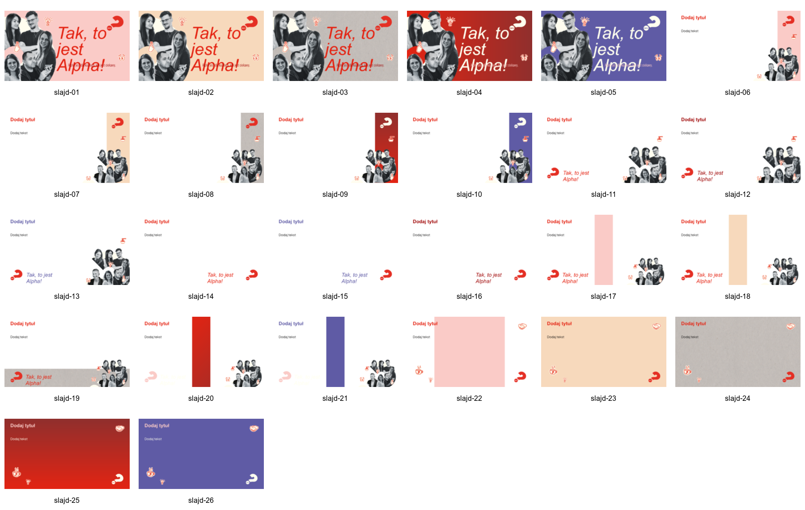
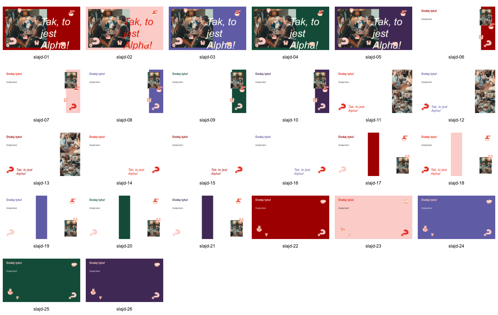

# Elementy brandingu wydobyte z prezentacji

Ten katalog przechowuje elementy wizualne wydobyte z [[Prezentacja_vA.pptx]] i [[Prezentacja_vB.pptx]], aby można było korzystać z identyfikacji Alpha bez otwierania prezentacji źródłowych.

## Zawartość

### Zdjęcia

Katalog [`zdjecia/`](zdjecia/) zawiera cztery oryginalne fotografie spotkań przy stole:

- dwa pionowe kadry używane na okładkach i bocznych pasach;
- dwa poziome kadry pokazujące uczestników przy stole.

Pliki zachowują rozdzielczość zapisaną w prezentacji.

### Wycięcia postaci

Katalog [`wyciecia/`](wyciecia/) zawiera plik `zespol-alpha.png`: czarno-białą kompozycję postaci na przezroczystym tle, używaną w wariancie A.

### Tekstury

Katalog [`tekstury/`](tekstury/) zawiera szarą fakturę papieru lub betonu używaną jako tło w wariancie A.

### Układy

Katalog [`uklady/vA/`](uklady/vA/) zawiera 26 układów wariantu A, a [`uklady/vB/`](uklady/vB/) 26 układów wariantu B. Każdy slajd został zachowany jako obraz PNG 1200 × 675 px.

Układy dzielą się na następujące grupy:

| Slajdy | Rodzaj układu |
| --- | --- |
| 01–05 | okładka z dużym zdjęciem lub wycięciem postaci, ikonami i hasłem „Tak, to jest Alpha!” |
| 06–10 | jasna plansza tekstowa z pionowym pasem koloru, zdjęciem lub grupą postaci przy prawej krawędzi |
| 11–13 | jasna plansza z fotografią albo wycięciem po prawej i podpisem Alpha w stopce |
| 14–16 | minimalistyczna plansza tekstowa z logo i podpisem w dolnej części |
| 17–21 | jasna plansza z mocnym pionowym pasem koloru i małą fotografią lub wycięciem |
| 22–26 | plansza pełnokolorowa z ikonami w narożnikach, przeznaczona na krótki tekst |

## Pozostałe elementy

- ikony z przezroczystością: [`../ikony/oryginalne/`](../ikony/oryginalne/);
- ikony na czerwonym tle Alpha: [`../ikony/na-tle-alpha/`](../ikony/na-tle-alpha/);
- logo w formatach SVG i PNG: [`../logo/`](../logo/);
- fonty, kolory i opis stylu: [[Grafiki na wydarzenie/README]].

## Ograniczenie po usunięciu prezentacji

Zdjęcia, wycięcie postaci, tekstura, ikony i logo zachowują oryginalne pliki osadzone w PPTX. Układy zostały zachowane jako obrazy referencyjne, dlatego po usunięciu prezentacji nie będzie można edytować ich poszczególnych pól, kształtów i położeń bez odtworzenia projektu.

